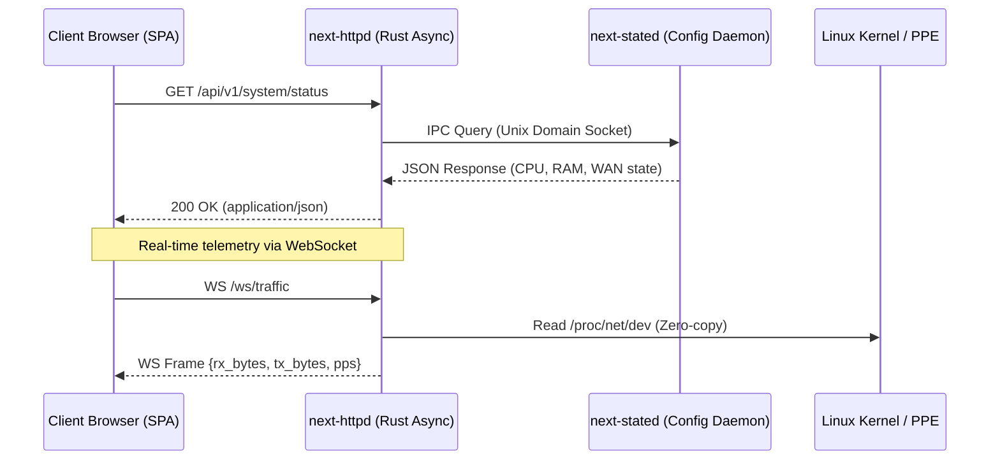

# Padavan-Next: System Architecture Specification

This document provides an exhaustive, in-depth technical analysis of the firmware architecture on the MediaTek MT7620A / SNR-CPE-MD1 platform, contrasting the legacy Padavan implementation with the **Padavan-Next** target architecture.

---

## 1. High-Level Architecture Overview

```mermaid
flowchart TD
    subgraph UI ["Presentation Layer"]
        A1["Legacy Web UI (ASP + EJ Macros + jQuery 1.8)"]
        A2["Modern UI (Static SPA: Preact/Vue + Tailwind CSS)"]
    end

    subgraph API ["Application / Service Layer"]
        B1["Legacy httpd (Single-threaded C + Sync Handler)"]
        B2["Target next-httpd (Async REST / WebSocket in Rust)"]
    end

    subgraph State ["Configuration & IPC Layer"]
        C1["Legacy NVRAM (Shared Memory + /dev/mtd1 Sync)"]
        C2["Target next-stated (Typed SQLite / JSON / atomic commit)"]
        C3["Kernel Netlink / sysfs / procfs"]
    end

    subgraph Core ["Process Supervisor & System Daemons"]
        D1["rc (PID 1: Monolithic State Machine)"]
        D2["dnsmasq (DNS / DHCP)"]
        D3["dropbear (SSH)"]
        D4["igmpproxy / udpxy (IPTV)"]
        D5["zapret (nfqws / tpws DPI Bypass)"]
    end

    subgraph Kernel ["Linux Kernel 3.4.113 MIPS"]
        E1["Ralink PPE / HWNAT (Flow Offload Engine)"]
        E2["Netfilter / iptables / NFQUEUE / IPSET"]
        E3["Wi-Fi Driver 2.4GHz (rt2860v2)"]
        E4["Wi-Fi Driver 5GHz (mt7610 PCIe)"]
    end

    subgraph Hardware ["MediaTek MT7620A Hardware"]
        F1["MIPS 24KEc CPU @ 580/600 MHz"]
        F2["64 MB DDR2 SDRAM"]
        F3["8 MB SPI NOR Flash"]
        F4["10/100M Fast Ethernet Switch"]
    end

    UI --> API
    API --> State
    State --> Core
    Core --> Kernel
    Kernel --> Hardware
```

---

## 2. Hardware Layer & Physical Constraints

### 2.1 MediaTek MT7620A SoC
- **CPU**: MIPS 24KEc, 32-bit single-core, single-issue architecture with MIPS32 Release 2 instruction set.
- **Clock**: Stock 580 MHz (CPU: 580 MHz, OCP bus: 193 MHz, SYS bus: 193 MHz). Overclockable via PLL registers to 600 MHz (`CONFIG_RALINK_MT7620_PLL600=y`).
- **L1 Cache**: 64 KB 4-way instruction cache (VIPT), 32 KB 4-way data cache (PIPT).
- **Embedded Switch**: 5-port 10/100 Mbps Ethernet switch (1 WAN, 4 LAN) with hardware VLAN tagging and internal PHYs.
- **Hardware Acceleration**: Packet Processing Engine (PPE / HWNAT) capable of line-rate 100 Mbps IPv4/IPv6 forwarding with zero CPU utilization.

### 2.2 Memory Constraints (64 MB DDR2)
- **Physical Address Space**: `0x00000000 - 0x04000000` (65,536 KB).
- **Kernel Reservation**: ~3.7 MB for kernel code and permanent slab caches.
- **ZRAM**: Compressed in-memory swap enabled at 50% RAM (~32 MB compressed block) with LZO/LZ4 compression.
- **Userland Headroom**: ~45-50 MB available for all concurrently running daemons, network buffers (`sk_buff`), and connection tracking tables (`nf_conntrack`).
- **Rule for Rewriting**: Any new daemon written in Rust or C must be lightweight, compiled with `opt-level = "z"`, `lto = true`, and consume less than **2-4 MB RSS**.

---

## 3. Flash Memory Map (8 MB SPI NOR Flash)

The SPI flash chip is a Winbond W25Q64BV (8,192 KB / 8 MB), mapped into 7 MTD partitions:

| MTD Partition | Name | Start Offset | End Offset | Size | Filesystem / Format | Description |
| :--- | :--- | :--- | :--- | :--- | :--- | :--- |
| `mtd0` | **Bootloader** | `0x00000000` | `0x00030000` | 192 KB | Raw binary | U-Boot bootloader (Read-only). |
| `mtd1` | **Config** | `0x00030000` | `0x00040000` | 64 KB | NVRAM format | Persistent NVRAM key-value store. |
| `mtd2` | **Factory** | `0x00040000` | `0x00050000` | 64 KB | Raw EEPROM | **CRITICAL READ-ONLY**: Wi-Fi RF calibration data, PA bias, and factory MAC addresses. Must NEVER be overwritten! |
| `mtd3` | **Kernel** | `0x00050000` | ~`0x00150000` | Variable | LZMA compressed | Linux kernel image (`zImage.lzma`). |
| `mtd4` | **RootFS** | ~`0x00150000` | `0x007E0000` | ~6.5 MB | SquashFS 4.0 XZ | Read-only compressed root filesystem. |
| `mtd5` | **Storage** | `0x007E0000` | `0x00800000` | 128 KB | Tar/Gzip archive | `/etc/storage` user scripts, certificates, and custom configs. |
| `mtd6` | **RWFS** | Optional | `0x00800000` | Remainder | JFFS2 | Optional writable overlay partition. |

> [!IMPORTANT]
> The single flashable firmware image (`.trx`) spans **`mtd3` (Kernel) + `mtd4` (RootFS)**. The maximum combined image size cannot exceed **7,929,856 bytes (~7.56 MB)**.

---

## 4. Kernel Architecture & Network Acceleration

### 4.1 Ralink HWNAT (Packet Processing Engine - PPE)
- The MT7620 SoC contains a dedicated hardware Flow Offload Engine (FOE).
- **Binding Phase**: The first 1-2 packets of a new TCP/UDP connection pass through the Linux Netfilter stack.
- **Hardware Acceleration**: Once established, the PPE binds the 5-tuple flow into an on-chip SRAM flow table. Subsequent packets are switched at line rate directly by the hardware engine without touching the CPU or kernel networking stack.
- **Compatibility**: NFQUEUE and DPI desynchronization (`nfqws`) work on the non-offloaded packets (flow initialization / HTTP request / TLS ClientHello). Once the handshake completes, bulk traffic can be accelerated by PPE.

### 4.2 Wi-Fi Architecture
- **2.4 GHz Driver**: Ralink `rt2860v2` SoC integrated driver (MT7620 built-in MAC/BBP/RF).
- **5 GHz Driver**: MediaTek `mt7610` PCIe driver (MT7610EN external RF transceiver).
- **Communication**: Controlled via `iwpriv` and standard `wireless_tools` ioctl interfaces.

---

## 5. Legacy Userland Architecture & Bottlenecks

### 5.1 Root Causes of Web UI Lags in Legacy Padavan
1. **Single-Threaded Blocking `httpd`**:
   The web server processes requests serially. If an ASP page executes an external process (like `detect_internet` or `mii_mgr`), the entire web server halts until that command exits.
2. **Synchronous Server-Side ASP/EJ Templating**:
   Every `.asp` file contains dozens of `<% nvram_get_x("", "param"); %>` and `<% nvram_dump(...); %>` macros. On each page request, `ej.c` parses every byte of the file using tiny 128-byte buffers, executing hundreds of string comparisons and NVRAM lookups.
3. **No Browser Caching**:
   By default, all scripts and pages were served with `Cache-Control: no-cache, no-store, must-revalidate`. A user clicking a tab forced the browser to re-download 6 static JS files (~115 KB) over 6 sequential HTTP connections.
4. **Aggressive Client-Side Polling**:
   `state.js` ran 3 background polling timers concurrently:
   - `get_system_info()` every 2000 ms.
   - `get_changed_status()` every 1000–5000 ms.
   - Periodic client list iframe reloads.
   Together, these flooded the single-threaded `httpd` with 2–3 requests per second continuously.

### 5.2 Legacy NVRAM & Process Management (`rc`)
- All system configurations are stored in an unindexed key-value array in memory (`nvram_handle`).
- To save settings, the array is written to a temporary block, compressed, and written to `/dev/mtd1`.
- Changes require `rc` to execute coarse-grained restart commands (`restart_firewall`, `restart_wan`, `restart_services`), frequently causing momentary dropped packets or interface resets.

---

## 6. Padavan-Next: The Modern Architecture

### 6.1 Guiding Principles
- **Decoupled Architecture**: Separate the UI completely from the backend via a clean, versioned REST / WebSocket API.
- **Zero-Copy & Memory Safety**: Leverage **Rust** for critical userland micro-services to prevent buffer overflows and achieve optimal memory footprint.
- **Static Single-Page Application (SPA)**: The web UI is compiled down to a single bundle of static HTML/JS/CSS, gzipped, and served with immutable cache headers. The browser loads the UI once; all subsequent interactions occur over JSON APIs.

### 6.2 Target Daemon Layout

1. **`next-httpd`**:
   - Ultra-compact async HTTP/WebSocket server in Rust.
   - Serves static assets with `ETag` and `max-age=31536000`.
   - Exposes REST endpoints (`/api/v1/*`) and WebSocket streams (`/ws/telemetry`).
2. **`next-stated`**:
   - Centralized, typed configuration manager.
   - Validates all input schemas before applying.
   - Granular notifications: updating Wi-Fi settings notifies only the Wi-Fi subsystem without tearing down WAN or firewall.
3. **`next-zapret`**:
   - Integrated DPI management supervisor.
   - Manages `nfqws` processes, NFQUEUE rules, hostlists, and strategy profiles dynamically without requiring manual shell script edits.
