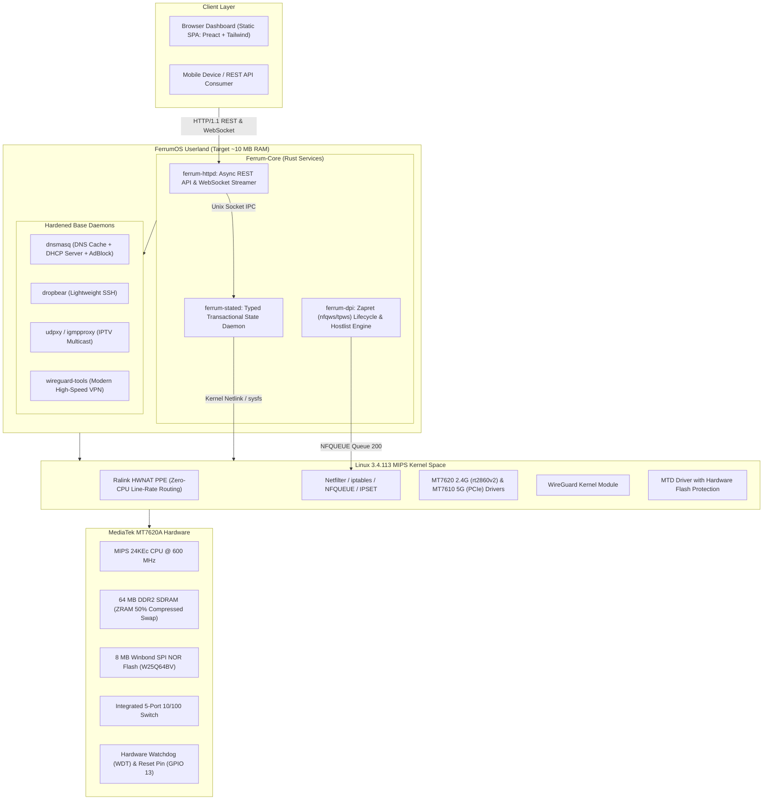

# FerrumOS: System Architecture & Design Specification

> **FerrumOS** is a modernized, ultra-lightweight, memory-safe, and anti-brick firmware architecture designed specifically for the MediaTek MT7620A SoC and NAG SNR-CPE-MD1.1 hardware.

---

## 1. High-Level Architecture Diagram



---

## 2. Core Architectural Principles

### 2.1 Principle 1: Fail-Safe & Anti-Brick by Design
- **Read-Only Critical Partitions**: `mtd0` (Bootloader) and `mtd2` (Factory EEPROM calibration data) are permanently locked as read-only at the kernel MTD driver level. No user command, script, or bug can ever wipe them.
- **Atomic Config Double-Buffering**: Settings stored in `mtd1` use a transactional A/B format with CRC32 checksums. If power is pulled mid-write, FerrumOS reverts cleanly to the previous valid revision.
- **Fail-Safe Web Recovery Mode**: Holding the physical Reset button (GPIO 13) for 3 seconds on boot launches an in-memory emergency recovery HTTP server for 1-click firmware upload.
- **Hardware Watchdog Guard**: The MT7620 hardware WDT automatically reboots the router into safe-mode if a kernel lockup occurs.

### 2.2 Principle 2: Aggressive Bloat Elimination
- **Zero USB Overhead**: The SNR-MD1.1 has no external USB port. FerrumOS purges all USB storage bloat (`samba`, `vsftpd`, `transmission`, `aria2`, `minidlna`, `uqmi`).
  - **Flash Saved**: ~3.85 MB.
  - **RAM Saved**: ~16 MB.
- **Retirement of Insecure Legacy VPNs**: `pptp` and `l2tp` servers and `strongswan` IPsec are purged in favor of native in-kernel **WireGuard** (~120 KB).
- **Abolition of Server-Side ASP**: The monolithic C `httpd` with its slow, synchronous ASP/EJ macro parser is eliminated.

### 2.3 Principle 3: Instant, Zero-Lag Frontend (Single-Page App)
- The entire web UI is an optimized **Preact/Tailwind Single-Page Application** (~70 KB gzipped).
- The browser downloads the application bundle once. Navigation between tabs is **0 milliseconds** (local client routing).
- All device state is retrieved asynchronously over clean JSON endpoints (`/api/v1/*`), and telemetry is streamed via WebSockets (`/ws/telemetry`).

### 2.4 Principle 4: First-Class Anti-Censorship (Ferrum-DPI)
- Native integration of **Zapret v72.13** (`nfqws` wire-speed zero-copy packet desync).
- Multi-strategy hardware bypassing:
  1. **YouTube 4K & YouTube Music**: TLS ClientHello desynchronization (`fake,multidisorder` with `split-pos=1,midsld` and `badseq,md5sig` fooling).
  2. **Discord Voice**: UDP ports 50000–65535 L7 `discord,stun` packet bypassing.
  3. **QUIC Drop (UDP 443)**: Enforces HTTP/2 over TLS for flawless playback without ISP throttling.
  4. **Dynamic Hostlist Sync**: Automated in-memory IPSET and domain list updates without disk writes.

---

## 3. Memory & Flash Budget

### 3.1 Flash Memory Allocation (8 MB Winbond SPI NOR)
| Partition | Name | Size | Usage in FerrumOS | Status |
| :--- | :--- | :--- | :--- | :--- |
| `mtd0` | Bootloader | 192 KB | U-Boot (Untouched) | **Locked (RO)** |
| `mtd1` | Config | 64 KB | Transactional A/B NVRAM | Read/Write (Safe) |
| `mtd2` | Factory | 64 KB | Wi-Fi EEPROM & MACs | **Locked (RO)** |
| `mtd3+mtd4` | Kernel + RootFS | ~7.56 MB max | **~3.5 MB actual** | Compressed XZ (~4 MB Free!) |
| `mtd5` | Storage | 128 KB | User TLS certs / keys | Gzip archive |

### 3.2 RAM Budget (64 MB DDR2 SDRAM)
```
+------------------------------------------------------------------------+
|                   Physical RAM: 64 MB (65,536 KB)                      |
+-------------------+--------------------+-------------------------------+
| Kernel + Drivers  | FerrumOS Daemons   | Free Headroom / Page Buffers  |
| ~12 MB            | ~10 MB             | ~42 MB (65% FREE)             |
+-------------------+--------------------+-------------------------------+
| PPE Flow Engine   | ferrum-httpd: ~2MB | nf_conntrack flow table       |
| Netfilter stack   | ferrum-stated:~2MB | sk_buff socket buffers        |
| Wi-Fi drivers     | dnsmasq: ~1.5MB    | ZRAM compressed swap buffer   |
| MIPS core slab    | zapret (nfqws):~2MB| Zero OOM freezes under load   |
+-------------------+--------------------+-------------------------------+
```

---

## 4. Subsystem Modernization Details

### 4.1 Configuration Subsystem (`ferrum-stated`)
- Written in **Rust** (compiled for `mipsel-unknown-linux-musl`).
- Configuration schema defined as strongly-typed structs with `serde`.
- Changes are validated before being applied (e.g. valid IP addresses, subnets, valid Wi-Fi channels).
- Emits fine-grained events: changing Wi-Fi password re-keys the wireless AP via driver ioctl without taking down WAN or restarting the firewall.

### 4.2 Web Server Subsystem (`ferrum-httpd`)
- Lightweight, asynchronous HTTP/1.1 and WebSocket server written in **Rust** using an `epoll`-based event loop.
- Stripped binary size: `< 750 KB`.
- Memory footprint: `< 2.5 MB RSS`.
- Serves embedded pre-compressed assets (`include_bytes!`) directly from flash without temporary disk extraction.
- Exposes versioned REST API (`/api/v1/system`, `/api/v1/network`, `/api/v1/wifi`, `/api/v1/dpi`).

### 4.3 Network Acceleration (`HWNAT PPE`)
- MediaTek's proprietary Packet Processing Engine (PPE) is preserved and optimized in the kernel.
- **Hybrid Offload**: The initial TCP handshake packets (SYN, SYN-ACK, HTTP GET, TLS ClientHello) are handled by Netfilter and intercepted by `nfqws` in NFQUEUE for DPI desynchronization. Once established, the flow is bound to the hardware FOE table, enabling line-rate 100 Mbps throughput at **0% CPU usage**.
